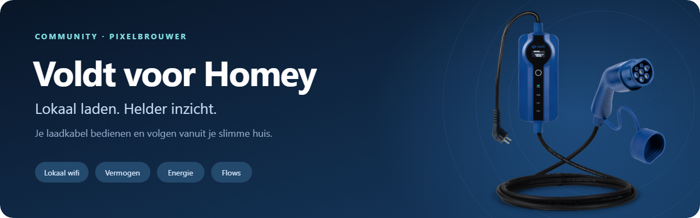

# Voldt for Homey

[Nederlands](README.md) · [Visual walkthrough](docs/ZO-WERKT-HET.nl.md) · [English guide](GUIDE.en.md)



Independent MIT-licensed Homey Pro app by [PixelBrouwer](https://github.com/PixelBrouwer). Control a compatible Voldt Wi-Fi charging cable over the local network and follow charging power and energy in Homey.

This repository contains the **sanitized source snapshot of version 1.0.0**. That version was submitted to Athom for certification; submission does not mean approval or availability in the Homey App Store.

> [!WARNING]
> **Not yet certified by Athom/Homey.** This app has been submitted for review but has not received official certification. Installation and use are entirely at your own risk. PixelBrouwer will update this repository once the app is certified.

## Features

- Local charging start/stop with authenticated status confirmation.
- Homey pairing/reconnect using a Voldt email/password account, when the build has its private OEM configuration.
- Automatic retrieval and validation of the device key and charging schema.
- Charging power (W), cumulative/session energy (kWh, where reported), temperature, current limit and charging state.
- Standard Homey charging Flows, Energy and Insights.
- English and Dutch user interfaces; reconnect an existing device without removing its Flows.

## Interface examples

| Pairing form | Illustrative device panel |
| --- | --- |
|  |  |

These documentation images contain synthetic data. Pairing and settings forms are rendered from the actual app HTML; their surrounding frame is illustrative. The device panel is a labeled mock-up, not a screenshot of Homey's exact native layout. See the [Dutch visual guide](docs/ZO-WERKT-HET.nl.md) and [image provenance](docs/images/README.md).

Hardware tested: Homey Pro (2026), Voldt Schuko 230 V / 3.7 kW Wi-Fi cable, firmware V4.0.2, LAN protocol 3.5. Requires Homey 12.9 or newer. Other models have not been claimed as hardware-tested. Homey Cloud/Bridge, Bluetooth-only cables, OCPP, Apple/Google sign-in and captcha UI are not supported.

## Sanitization and private configuration

**No personal account/device credentials or OEM signing secrets are included.** The working private/production build has OEM mobile-app configuration that is deliberately omitted here. Therefore the public source is not an out-of-the-box replacement for the configured production build: account login requires separately supplied private configuration. Local operation with an already configured device does not require that file.

For an authorized development build, copy `lib/voldt-app-identity.example.json` to `lib/voldt-app-identity.json` and provide the OEM app configuration through a private channel. The actual file is ignored by Git. These fields are app integration settings, not your Voldt email/password or cable key. The project does not supply the omitted values. See [SECURITY.md](SECURITY.md).

The sanitized factory loads private configuration only when account login is requested, so missing configuration does not crash app startup. Its error is translated in both languages. Charging logic is unchanged from 1.0.0. No APKs, research dumps, real device IDs/IP addresses, account sessions, Homey tokens or personal commit email are published.

## Use and develop

Read the [Dutch guide](GUIDE.nl.md) or [English guide](GUIDE.en.md). First connect the cable to Wi-Fi in the official Voldt app. Once the configured Homey build is installed, pair through **Devices → Add device → Voldt**. Reconnect through **More → Apps → Voldt → App settings**.

Runtime uses Node.js standard libraries and the Homey SDK. Unit/integration tests require Node.js 22+ and no package installation:

```sh
npm test
```

With the official Homey CLI installed and the private OEM configuration supplied when account login is needed:

```sh
homey login
homey select
homey app validate --level publish
homey app install
```

Do not use `--clean` when updating an existing installation. It removes device data.

The public suite covers protocol authentication, read-only setup, switching confirmation, schema/telemetry mapping, secret-free frontend responses, reconnect and startup without private configuration. Test credentials and cryptographic keys are synthetic fixtures. Four tests for a separate research-only PC setup server are not part of this app repository.

## License and provenance

Original integration source is [MIT licensed](LICENSE). Vendor brands and artwork are subject to [third-party notices](THIRD_PARTY_NOTICES.md). Generated image references and prompts are documented in [ASSETS.md](ASSETS.md). This app is not affiliated with or endorsed by Voldt, Tuya or Athom.
