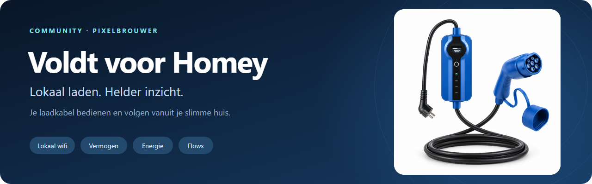
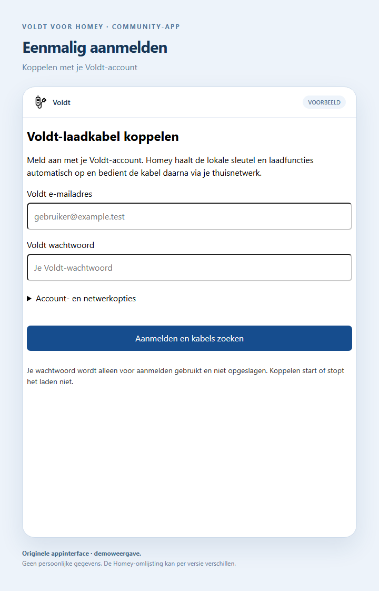
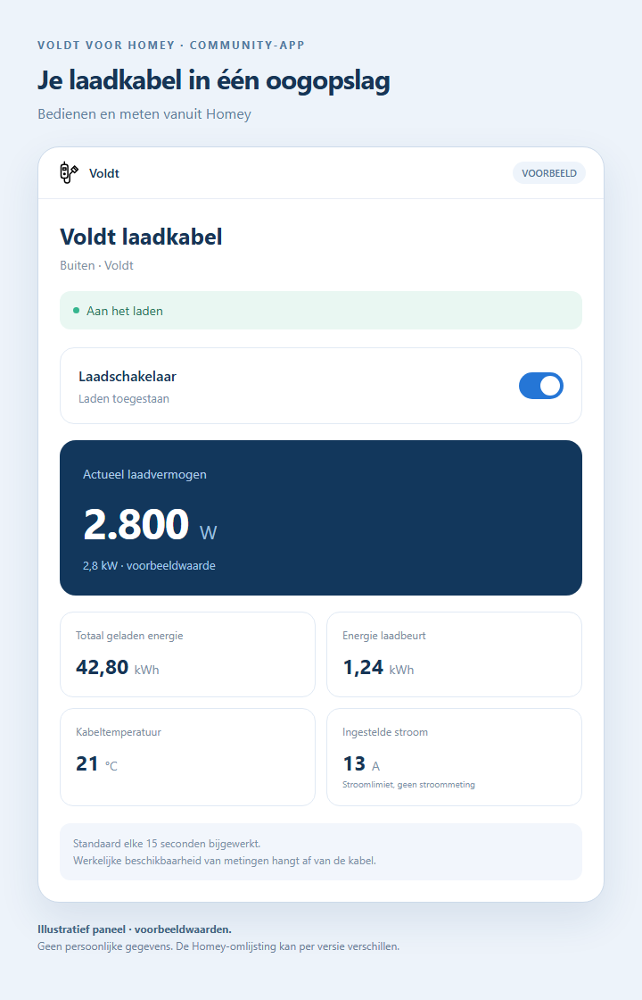
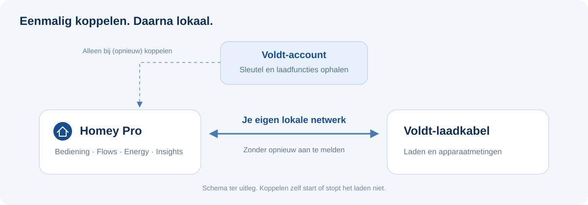

<p align="center">
  
</p>

<p align="center">
  <a href="https://github.com/PixelBrouwer/homey-voldt/releases/tag/v1.0.0"></a>
  
  
  <a href="LICENSE"></a>
</p>

<p align="center">
  <strong>Je Voldt-laadkabel als onderdeel van je slimme huis.</strong><br>
  Laden aan of uit, actueel vermogen bekijken en laadbeurten volgen vanuit Homey.
</p>

<p align="center">
  <a href="GUIDE.nl.md">Handleiding</a> ·
  <a href="docs/ZO-WERKT-HET.nl.md">Bekijk de schermen</a> ·
  <a href="https://github.com/PixelBrouwer/homey-voldt/releases/tag/v1.0.0">Download v1.0.0</a> ·
  <a href="README.en.md">English</a>
</p>

> [!WARNING]
> **Nog niet gecertificeerd door Athom/Homey.** Deze app is ingediend voor beoordeling, maar heeft nog geen officiële certificering. Installatie en gebruik zijn volledig op eigen risico. Zodra de app is gecertificeerd, werkt PixelBrouwer deze repository bij.

## Wat kun je ermee?

Deze onafhankelijke community-app van [PixelBrouwer](https://github.com/PixelBrouwer) verbindt een geschikte Voldt-wifilaadkabel met **Homey Pro**. In een geconfigureerde build meld je eenmalig aan met je Voldt-account. Homey haalt de lokale sleutel en laadfuncties op en controleert de verbinding. Daarna lopen bediening en metingen rechtstreeks over je eigen netwerk.

| Bedienen | Inzicht | Automatiseren |
| --- | --- | --- |
| Laden aan- en uitzetten | Vermogen in W en energie in kWh | Laden plannen met Homey Flows |
| Bestaande koppeling herstellen | Temperatuur, stroomlimiet en laadstatus | Metingen volgen in Energy en Insights |
| Geen pc nodig voor dagelijks gebruik | Meetwaarden rechtstreeks van de kabel | Je bestaande apparaat en Flows behouden |

> [!IMPORTANT]
> **Dit is de gesanitiseerde broncode van versie 1.0.0.** Persoonlijke gegevens én OEM-inloggeheimen zijn weggelaten. Zelfgebouwde versies hebben voor Voldt-accountlogin afzonderlijke private OEM-configuratie nodig. De werkende productiebuild bevat die configuratie; deze openbare download is daardoor geen direct inzetbare vervanging. Zie [Broncode en privacy](#broncode-en-privacy).

## Zo ziet het eruit

<table>
  <tr>
    <td width="50%" align="center"><a href="docs/images/koppelen.png"></a></td>
    <td width="50%" align="center"><a href="docs/images/apparaatpaneel-voorbeeld.png"></a></td>
  </tr>
  <tr>
    <td><strong>1. Eenmalig koppelen</strong><br>Het echte appformulier, gerenderd met demogegevens. Homey haalt de benodigde gegevens automatisch op.</td>
    <td><strong>2. Bedienen en meten</strong><br>Illustratief paneel met voorbeeldwaarden. De werkelijke Homey-indeling kan afwijken.</td>
  </tr>
</table>

De beelden bevatten geen echte accountgegevens of live metingen. Het koppelformulier komt uit de appcode; de omlijsting en het apparaatpaneel zijn documentatievoorbeelden. Klik op een beeld voor de volledige grootte. **[Bekijk ook koppeling herstellen →](docs/ZO-WERKT-HET.nl.md#3-je-bestaande-koppeling-herstellen)**

## Eenmalig aanmelden, dagelijks lokaal



1. Verbind de kabel eerst met wifi in de officiële Voldt-app.
2. Open in een geconfigureerde Homey-build **Apparaten → + → Nieuw apparaat → Voldt**.
3. Meld aan met je Voldt-e-mailadres en wachtwoord. Kies de gevonden kabel en een zone, bijvoorbeeld **Buiten**.
4. Bedien de kabel vanuit Homey. Voor dagelijks gebruik hoef je niet opnieuw aan te melden.

Een bestaande kabel opnieuw koppelen? Open **Meer → Apps → Voldt → App configureren**. Je hoeft het apparaat of je Flows niet te verwijderen. Koppelen zelf start of stopt het laden niet.

**[Volledige Nederlandse handleiding →](GUIDE.nl.md)**

## Wat laat Homey zien?

| Veld | Betekenis |
| --- | --- |
| **Laadschakelaar** | Laden toestaan of stoppen. De auto moet laden kunnen accepteren. |
| **Actueel laadvermogen** | Gemeten vermogen in W; 2.800 W is 2,8 kW. |
| **Totaal geladen energie** | De totaalteller van de kabel in kWh. |
| **Energie laadbeurt** | Sessieteller in kWh, als de kabel die rapporteert. |
| **Kabeltemperatuur** | Temperatuur in °C. |
| **Ingestelde stroom** | Stroomlimiet in A; geen gemeten laadstroom. |
| **Laadstatus** | Onder meer aangesloten, wachten, laden, pauze, gereed of storing. |

Homey leest standaard elke **15 seconden**. Beschikbare meetwaarden hangen af van de kabel en firmware. Ontbrekende waarden blijven onbekend; een gerapporteerde nul blijft nul. De app verzint geen kWh op basis van vermogen.

Gebruik in Flows bijvoorbeeld **Begin met opladen** op een gekozen tijdstip en **Stop met opladen** in een tweede Flow. De laadschakelaar geeft toestemming; het werkelijke laden zie je aan de status en het vermogen.

## Geschiktheid en status

| Onderdeel | Status |
| --- | --- |
| Homey Pro (2026) | Getest; Homey 12.9 of nieuwer vereist. |
| Homey Pro (2023) | Dezelfde lokale apparchitectuur; niet afzonderlijk op hardware getest. |
| Voldt Schuko 230 V / 3,7 kW wifi | Getest met firmware V4.0.2 en LAN-protocol 3.5. |
| Andere Voldt-uitvoeringen | Niet als getest aangemerkt. |
| Homey Cloud/Bridge, alleen Bluetooth, OCPP | Niet ondersteund. |
| Homey App Store | Versie 1.0.0 is ingediend voor certificering; dit is geen goedkeuring. |

## Broncode en privacy

Deze repository bevat de zelfstandige app, documentatie en synthetische testgegevens. Echte wachtwoorden, kabelsleutels, Homey-tokens, accountsessies, apparaat-ID's, netwerkgegevens, OEM-inloggeheimen en APK's zijn niet opgenomen. Zie [de controlebeschrijving](SANITIZATION.md).

Voor een geautoriseerde eigen build kopieer je `lib/voldt-app-identity.example.json` naar `lib/voldt-app-identity.json` en lever je de private OEM-configuratie afzonderlijk aan. Het echte configuratiebestand is uitgesloten van Git. Dit zijn integratiegegevens van de app; vul hier **geen** Voldt-wachtwoord of kabelsleutel in. Deze repository levert de ontbrekende waarden niet.

Zonder die configuratie start de app wel op, maar geeft accountlogin een duidelijke melding. Bestaande lokale bediening met al opgeslagen apparaatgegevens heeft het bestand niet nodig. Lees [SECURITY.md](SECURITY.md) voordat je zelf bouwt of informatie deelt in een issue.

<details>
<summary><strong>Ontwikkelen en zelf installeren</strong></summary>

Node.js 22+ vereist. De app gebruikt standaardbibliotheken en de Homey SDK; de tests hebben geen extra pakketten nodig.

```sh
npm test
```

De openbare broncode bevat **67 geslaagde tests** en is gevalideerd op Homey-niveau `publish`. De tests controleren onder meer protocolauthenticatie, laadbevestiging, koppelen zonder laadcommando's en het afschermen van sleutels. Vier tests voor een losse onderzoeksserver zijn weggelaten; één test voor starten zonder private configuratie is toegevoegd.

Installeer de officiële Homey CLI en gebruik vanuit de appmap:

```sh
homey login
homey select
homey app validate --level publish
homey app install
```

Accountlogin vereist de hierboven beschreven private OEM-configuratie. Gebruik bij updates geen `--clean`; daarmee worden apparaatgegevens verwijderd. Een ZIP is niet rechtstreeks via de mobiele Homey-app te installeren.

</details>

## Meer weten

- [Nederlandse handleiding](GUIDE.nl.md) — koppelen, gebruiken, Flows en problemen oplossen.
- [Visuele rondleiding](docs/ZO-WERKT-HET.nl.md) — drie schermvoorbeelden met uitleg.
- [English documentation](README.en.md) — overview and development notes.
- [Release v1.0.0](https://github.com/PixelBrouwer/homey-voldt/releases/tag/v1.0.0) — broncode-ZIP en checksum.

---

Oorspronkelijke appbroncode: **[MIT](LICENSE)** · Auteur: **[PixelBrouwer](https://github.com/PixelBrouwer)**.

Onafhankelijke community-integratie; niet verbonden aan of goedgekeurd door Voldt, Tuya of Athom. Merken en productvormgeving blijven van hun eigenaren. Zie [bronvermeldingen](THIRD_PARTY_NOTICES.md), [Store-beeldmateriaal](ASSETS.md) en [documentatiebeelden](docs/images/README.md).
