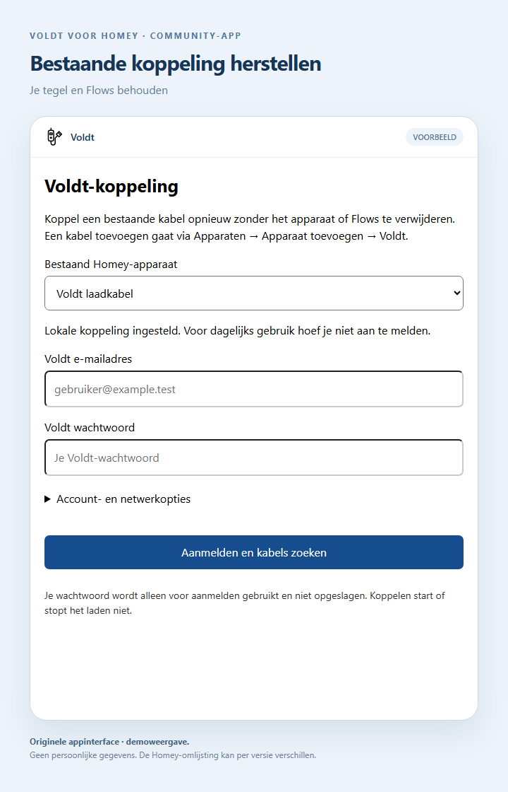

# Voldt in Homey: zo werkt het

[Terug naar de hoofdpagina](../README.md) · [Volledige handleiding](../GUIDE.nl.md) · [English](../README.en.md)

> [!WARNING]
> Deze app is nog niet officieel gecertificeerd door Athom/Homey. Installatie en gebruik zijn volledig op eigen risico. PixelBrouwer werkt deze repository bij zodra de certificering is verleend.

Deze rondleiding laat de werkwijze van een **geconfigureerde build** zien. De openbare broncode is gesanitiseerd: voor accountlogin in een eigen build is afzonderlijke private OEM-configuratie nodig. Zie [README](../README.md#broncode-en-privacy).

Alle beelden zijn documentatievoorbeelden met synthetische gegevens, zonder echte accountinformatie of live metingen. Het koppel- en instelformulier zijn gerenderd uit de echte appcode. De omlijsting en het apparaatpaneel zijn illustratief; de werkelijke Homey-indeling kan per versie verschillen.

## 1. Je kabel koppelen

Zet de kabel eerst op wifi via de officiële Voldt-app. Open daarna **Homey → Apparaten → + → Nieuw apparaat → Voldt** en meld aan met je Voldt-account.

Homey haalt de lokale sleutel en de laadfuncties op, controleert ze en biedt de bereikbare kabel aan. Kies je kabel, naam en zone. Bij **Account- en netwerkopties** kun je zo nodig landcode, regio en lokaal IP-adres instellen. Voor een Nederlands account is dat meestal **31 / Europa**.

Je hoeft geen sleutel, apparaat-ID of DP-nummer over te typen. Je wachtwoord wordt niet opgeslagen. Koppelen leest de huidige instelling en start of stopt het laden niet.

## 2. Bedienen en meten

Open de kabel onder **Apparaten**, bijvoorbeeld in de zone **Buiten**. De laadschakelaar geeft toestemming voor laden; de auto en de beveiligingen van de kabel bepalen of er daadwerkelijk stroom loopt.

Dit paneel is een **illustratie van de functies**, geen exacte schermafbeelding van de native Homey-app. Alle waarden zijn fictief. Beschikbaarheid van sensoren en de precieze Homey-weergave kunnen afwijken.

| Wat wil je weten? | Waar kijk je? |
| --- | --- |
| Mag de kabel laden? | **Laadschakelaar**. |
| Wordt er daadwerkelijk geladen? | **Laadstatus** en **Actueel laadvermogen**. |
| Hoeveel vermogen wordt gebruikt? | **Actueel laadvermogen** in W; delen door 1.000 geeft kW. |
| Hoeveel energie is geladen? | **Totaal geladen energie** en, indien gerapporteerd, **Energie laadbeurt**, beide in kWh. |
| Welke stroomlimiet staat ingesteld? | **Ingestelde stroom** in A. Dit is geen stroommeting. |

De app leest standaard elke 15 seconden. Ontbrekende waarden blijven onbekend; gerapporteerde nullen worden niet vervangen door schattingen. Voor grafieken en energieoverzichten gebruik je Homey Insights en Energy.

## 3. Je bestaande koppeling herstellen

Na een gewijzigd IP-adres, wifi-reset of nieuwe lokale sleutel hoef je de Homey-tegel niet te verwijderen. Open **Meer → Apps → Voldt → App configureren**.

Selecteer je bestaande apparaat, meld aan, kies de gevonden kabel en klik **Lokale koppeling herstellen**. Homey koppelt uitsluitend dezelfde fysieke kabel opnieuw aan dit apparaat. Naam, zone en Flows blijven behouden. Deze route werkt ook als je geen knop Onderhoud of Repareren ziet.

## 4. Laden automatiseren

Maak bijvoorbeeld een Flow met een tijdstip als trigger en de actie **Begin met opladen** voor je kabel. Maak een tweede Flow met **Stop met opladen**. De auto moet aangesloten zijn en laden accepteren.

De standaard laadvoorwaarde volgt de laadschakelaar. Voeg een vermogensvoorwaarde toe als je werkelijk energiegebruik wilt controleren. Een ingeschakelde schakelaar betekent niet altijd dat de auto al stroom afneemt.

## Wat gebeurt er achter de schermen?

Alleen koppelen of een sleutel opnieuw ophalen vereist het Voldt-account en internet. Daarna gebruikt Homey de opgeslagen lokale sleutel. Een pc, cloudontwikkelaarsproject of verhuizing naar Smart Life is voor dagelijks gebruik niet nodig.

Verdere uitleg en foutmeldingen: [Nederlandse handleiding](../GUIDE.nl.md). Herkomst en reproduceerbaarheid van de beelden: [documentatiebeelden](images/README.md).
